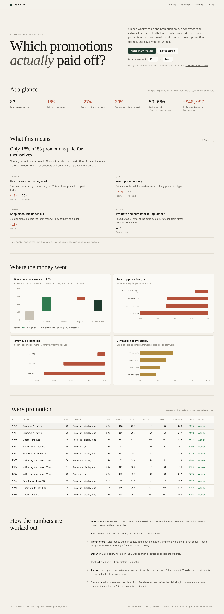

# Promo Lift Analyzer

**Which trade promotions actually paid off?** Upload weekly sales and promotion data for consumer-goods products. The engine separates real incremental sales from sales that were only borrowed from sister products or from the following weeks, prices each promotion's ROI from the brand's side, and an LLM explains in plain English what to run more of, what to stop and what to change.

Live demo: https://promo-lift-analyzer.vercel.app



## What it does

| Step | Output |
|---|---|
| **Ingest** | CSV/Excel upload with column and row-level validation (missing columns, non-numeric values with row numbers, duplicates) |
| **Baseline** | Expected units per product × store × week without a promotion: rolling 13-week median of "clean" weeks (no promo, not in a post-promo window) |
| **Gross lift** | Actual promo-week units − baseline |
| **Cannibalization** | Units lost by sister products (same category, same store) during the promotion, counting only weeks the sister wasn't itself promoted |
| **Post-promo dip** | Units below baseline in the 2 weeks after the promotion (pantry loading) |
| **Net incremental** | Gross lift − cannibalization − dip |
| **ROI (brand view)** | (net incremental units × brand margin − discount cost) ÷ discount cost, where discount cost = (base price − promo price) × every unit sold on promotion. Margin is an input (default 40%) |
| **Readout** | Plain-English summary and 3–4 recommendations from an LLM (NVIDIA Nemotron 3 Ultra via OpenRouter) |

Store-level promotion runs are rolled up to chain-level events (same product, same start week) and summarized by promotion type (TPR only / + display / + feature / all three), discount depth and category.

## Keeping the LLM honest

The model never does math. It receives a compact set of **pre-formatted facts** computed in Python and must cite only those numbers. A guard extracts every number from the model's JSON output and rejects the response if any number is not in the facts; the model gets one retry, and otherwise the app falls back to a deterministic rule-based readout. Without an API key the app runs fully on the rule-based readout.

## Stack

- **Backend:** Python 3.12, FastAPI, pandas/numpy (Vercel Python function)
- **Frontend:** React 19 + Vite, Recharts
- **LLM:** OpenRouter, model `nvidia/nemotron-3-ultra-550b-a55b:free` (configurable)
- **Tests:** pytest with fixtures that have known answers (e.g. a promo with exactly 100 units of lift, 20 cannibalized, 30 lost to the dip → 50 net, ROI −50%)

## Sample data

The built-in sample is **synthetic**: 11 products in 4 categories (cold cereal, bag snacks, frozen pizza, mouthwash) across 25 stores and 104 weeks, modelled on the structure of dunnhumby's *Breakfast at the Frat* dataset (weekly units with TPR, display and feature flags). Promotion effects (price elasticity, display/feature uplift, cannibalization share by category, post-promo dip) are planted on purpose so the engine can be checked against a known truth. The generator is seeded and lives in `engine/sample.py`.

Any file with these columns works: `week, store_id, product_id, product_name, category, units, price, base_price, on_promo` (optional: `display, feature`).

## Run locally

```bash
pip install -r requirements.txt uvicorn pytest
uvicorn api.index:app --port 8000        # API on :8000
npm install && npm run dev               # UI on :5173, proxies /api to :8000
pytest -q                                # engine + readout tests
```

Set `OPENROUTER_API_KEY` (and optionally `OPENROUTER_MODEL`) to enable the AI readout.

## Project layout

```
api/index.py        FastAPI routes: /api/sample, /api/analyze, /api/readout, /api/sample.csv
engine/analysis.py  validation, baseline, events, lift / cannibalization / dip / ROI, summaries
engine/readout.py   facts builder, OpenRouter call, number guard, rule-based fallback
engine/sample.py    seeded synthetic dataset generator
src/                React dashboard
tests/              pytest suite
```

## Next steps toward production

Auth and saved analyses, Postgres storage keyed by `tenant_id`, a regression-based baseline (price, seasonality, holidays), store-level control groups (difference-in-differences), trade-spend and retailer-margin inputs, and an evaluation set that scores recommendations against known outcomes.

---
Built by Ravikoti Deekshith.
